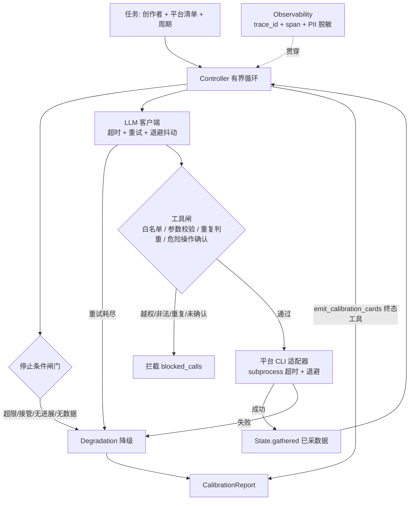

# 校准引擎 · 比赛 Agent（泛内容创作 / 自媒体运营）

> 基于知乎黑客松「看山创作校准引擎」业务逻辑新建的比赛 Agent 骨架。
> 解决的问题：**死循环、乱调工具、调用无界、一挂就崩、出事查不到**。
> 交付日期：2026-11-12 · 语言：Python 3.11+（实测 3.14.6）· 核心依赖：仅标准库。

---

## 0. 定位结论（先说查到了什么）

| 项 | 结论 |
|---|---|
| 原「校准引擎」代码 | 工作区 `kanshan-frontend` 目录（前端三屏 + `server.py` 网关 + `zhihu_scrape_v4.py` 兜底抓取） |
| 它是不是 Agent | **不是**。全目录 grep `chat.completions` / `langgraph` / `tool_call` = 0 命中，只有一个 `for i in range(args.scroll)` 滚动循环。它是抓取/网关项目，没有 LLM、没有工具调用循环 |
| 死循环/乱调工具的根因 | 工作区内**没有**那份出问题的 Agent 代码；因此按你的指示「基于校准引擎新建」 |
| 本次产出 | 一份可直接运行、带完整 guardrails 的比赛 Agent，见下方文件清单 |
| 业务逻辑继承 | 轨迹/数据采集 → 指标分析 → **校准动作卡**（platform / issue / evidence / action / priority） |

### C3 判断：真的需要 Agent 吗？

需要，但要说清为什么，不是默认上 Agent：

- 赛题要求「让 Agent 完成一段有业务规则的工作，强调外部工具调用和业务判断」——**多步 + 外部工具 + 动态判断**三要素齐备。
- 单次 LLM 调用做不到（无法采数）；固定 Prompt Chaining 也不够（平台清单是动态的、单平台失败要跳过而非整体失败、采集充分度需要判断何时收敛）。
- 选 **有界 Autonomous Loop + 终态工具收敛**；不选 Orchestrator-Workers（单创作者、平台数少，并行编排的复杂度收益为负）。
- 代价是引入不确定性，所以下面 **7 道主动停止闸门 + 3 个收敛/降级终止态（共 10 个 `reason_stopped` 枚举，见 §3）** 不是可选项，是上 Agent 的最低门票。

### 赛题对齐

| 赛题要求 | 落地位置 |
|---|---|
| 具体行业 | 泛内容创作 / 自媒体运营（`src/agent/domain.py`） |
| 具体岗位 | 内容运营校准师（`src/agent/prompts.py` 的 SYSTEM_PROMPT） |
| 业务规则 | `analyze_stats` / `analyze_post` / `suggest_actions_from_data`（互动率 2% 阈值、粉丝基数、有曝光无点赞、标题钩子/CTA 启发式） |
| 外部工具调用 | `fetch_platform_stats` / `fetch_platform_posts`，底层走各平台开发者 CLI |
| 业务判断 | LLM 基于工具返回的真实数据产出校准卡，`evidence` 字段可核查；禁止凭空编造数据（写进 system prompt） |

---

## 1. 架构



### 组件表

| 文件 | 职责 | 输入 | 输出 | 失败处理 |
|---|---|---|---|---|
| `src/agent/controller.py` | 有界循环、10 个 `reason_stopped` 终止态、编排 | task dict | `AgentResult` | 任一异常收敛为结构化降级结果，不抛给调用方 |
| `src/agent/tools.py` | 工具白名单 + JSON Schema + 参数校验 | tool_call | 允许/拒绝 | 越权返回 `allowed` 列表；非法参数返回明细 |
| `src/agent/loop_guard.py` | 按 `(工具名+排序参数)` 签名判重 | 调用签名 | 是否死循环 | 命中即拦截并强制停止 |
| `src/agent/llm_client.py` | LLM 超时/重试/降级 + Mock | messages + schemas | `LLMResponse` | 重试耗尽返回 `is_degraded=True` |
| `src/platforms/platforms.py` | 平台 CLI 适配（配置驱动） | platform/account/period | stats / posts dict | `PlatformError` → 控制器降级跳过 |
| `src/agent/domain.py` | 校准卡模型 + 业务规则 | stats / posts | `CalibrationCard` | 规则兜底，永不空手 |
| `src/agent/degradation.py` | 4 条降级路径 | state | 部分报告 | 降级标记写进 `report.degraded` |
| `src/agent/observability.py` | trace_id / span / PII 脱敏 | 任意事件 | 结构化日志 | 脱敏后才入日志 |
| `src/agent/prompts.py` | Prompt 版本化管理 | — | system + task | 单独文件，改动可回滚 |
| `src/agent/scenarios.py` / `factory.py` | 场景与装配 | 场景名 | 可运行控制器 | demo 与评测共用同一装配 |
| `main.py` / `tests/test_eval.py` | 入口 / 评测集 | CLI 参数 | 报告 + 指标 | 评测失败 `exit(1)` |

**平台适配是配置驱动，不是每个平台写一套代码**：`config.example.yaml` 的 `platforms.<name>.stats_cmd / posts_cmd` 填命令模板（`{account}` `{period}` `{limit}` 占位），stdout 输出 JSON 即可。示例给了 `devto`、`hashnode`，其余平台（medium/wechat/xiaohongshu/zhihu/bilibili 等）按同结构追加配置，代码零改动。

---

## 2. 问题 → 修复对照

| 症状 | 根因 | 修复点 |
|---|---|---|
| 死循环 | 无步数上限、无收敛判定、无重复检测 | `max_steps` 硬上限 + `LoopGuard` 签名判重 + `emit_calibration_cards` 终态工具 + 连续无进展检测 |
| 乱调工具 | 无工具白名单、无参数约束 | `ToolRegistry.is_allowed()` + `validate()` + `requires_confirmation` 危险操作闸 |
| 调用无界 | LLM/CLI 调用无超时、无重试策略 | LLM `timeout=30s` + 2 次重试 + 指数退避抖动；CLI `subprocess timeout=20s` + 2 次重试 + 退避抖动 |
| 一挂就崩 | 异常直接冒泡 | 工具失败返回结构化错误并跳过该平台；LLM 挂掉走规则兜底产出校准卡 |
| 出事查不到 | 无 trace、无拦截计数 | `trace_id` 贯穿 + span 埋点 + `blocked_calls` 量化"乱调工具" + 每条停止原因显式命名 |
| 停止原因含糊 | `for` 自然耗尽时停留在 `unknown` | `for/else` 显式命名 `max_steps`；无数据单独命名 `no_data`（不伪装成 `llm_no_tool`） |

---

## 3. 终止态清单（C5）· 10 个 `reason_stopped` 枚举

**口径单源**：代码里共 10 个终止态 = **7 道主动停止闸门**（#1/2/3/5/6/7/8）+ **1 个成功收敛**（#4）+ **2 个降级/收尾**（#9/10）。PRD、任务板、学生回执一律沿用下表的英文枚举名，禁止另造别名或另记数字。

| # | 条件 | 默认阈值 | 停止原因 | 是否有结果 |
|---|---|---|---|---|
| 1 | 步数上限 | `max_steps=12` | `max_steps` | 部分结果（降级） |
| 2 | 墙钟上限 | `max_wall_clock_s=120` | `wall_clock` | 部分结果（降级） |
| 3 | Token 预算 | `token_budget=8000` | `token_budget` | 部分结果（降级） |
| 4 | 终态工具 | 调用 `emit_calibration_cards` | `final_tool` | ✅ 完整结果 |
| 5 | 人工接管 | `human_takeover()` 返回 True | `human_takeover` | 部分结果（降级） |
| 6 | 连续无进展 | `max_no_progress=3` 步 | `no_progress` | 部分结果（降级） |
| 7 | 死循环 | 同签名调用 `> max_repeat=3` | `loop_detected` | 部分结果（降级） |
| 8 | 无数据 | 未采到数据且模型无文本 | `no_data` | 说明卡（不硬造结论） |
| 9 | LLM 不可用 | 重试耗尽 | `llm_degraded` | 规则兜底卡 |
| 10 | 模型主动收尾 | 不返回 tool_calls 且已有数据或文本 | `llm_no_tool` | 模型文本（否则被 #8 拦截） |

**Token 预算说明**：`est_tokens()` 是粗估（中文 ~1.5 字符/token），用于成本闸门，**不是精确计费**。

---

## 4. 错误 / 超时 / 降级矩阵（C4）

| 故障 | 可重试 | 次数 | 退避 | 降级路径 |
|---|---|---|---|---|
| LLM 超时 / 网络 / HTTP 5xx | 是 | 2 | `2.0 * 2^n` 秒 + 随机抖动(0~0.5s) | `is_degraded=True` → `llm_unavailable()` 用已采数据出规则卡 |
| LLM 返回结构异常 | 否 | — | — | 直接降级，标 `llm_unavailable` |
| CLI 超时 / 非零退出 / JSON 解析失败 | 是 | 2 | `0.5 * 2^n` 秒 + 抖动(0~0.2s) | `tool_failed` 结构化错误 → 跳过该平台继续；`data_availability[platform]="failed"` |
| 工具名越权 | 否 | — | — | `tool_not_allowed` + 回传允许清单，`blocked_calls++` |
| 参数非法 | 否 | — | — | `invalid_args` + 错误明细，`blocked_calls++` |
| 重复调用 | 否 | — | — | `loop_guard_blocked` → 强制停止 + 部分结果 |
| 危险工具未确认 | 否 | — | — | `confirmation_required` 拒绝执行 |
| 校准卡非法 | 否 | — | — | `invalid_cards` 拒绝，继续（连续失败触发 `no_progress`） |

**幂等**：所有工具均为只读采集；无写操作、无副作用，重试天然安全。若将来加发帖类工具，必须设 `requires_confirmation=True` 并注入 `AgentConfig.confirm_callback`。

---

## 5. 可观测性（Phase 4）

- `trace_id` 由 `Observability.start_trace()` 生成，贯穿整轮；`task_hash` 用任务内容哈希，不含 PII。
- span 名称：`llm_exception`、`degrade.llm_unavailable`、`degrade.loop_detected`、`end`。
- **脱敏**：`cookie`/`secret`/`token`/`password`/`authorization`/`api_key` 的值一律抹 `***`；超长字符串截断到 200 字符。
- 关键指标：`steps` / `llm_calls` / `tool_calls_total` / `tool_failures` / `blocked_calls` / `duration_ms` / `est_tokens` / `reason_stopped` / `degraded`。

样例（实跑 `loop` 场景）：

```json
{
  "trace_id": "tr_ed2c225f61784dd9",
  "reason_stopped": "loop_detected",
  "metrics": {"steps": 4, "llm_calls": 4, "tool_calls_total": 3,
              "tool_failures": 0, "blocked_calls": 1, "est_tokens": 0},
  "degraded": ["loop:fetch_platform_stats"],
  "data_availability": {"devto": "ok"}
}
```

读法：第 4 次重复调用被守卫拦截（`blocked_calls=1`），未执行的调用不计入 `tool_calls_total`；降级用已采到的 `devto` 数据产出说明卡。

---

## 6. 运行与验证（Phase 2 / 5）

```bash
# 在解压出来的项目根目录下执行（本机 Python 路径请替换为自己的，或直接用 python）
python main.py --scenario normal     # 正常收敛 -> final_tool
python main.py --scenario loop       # 死循环被拦 -> loop_detected
python main.py --scenario llmdown    # LLM 挂掉 -> llm_degraded
python main.py --scenario tooldown   # 平台失败跳过 -> final_tool + degraded

# 人工接管演示：创建 stop 文件即停止
python main.py --stop-file ./STOP

# 评测集
python tests/test_eval.py
```

**实测结果（2026-11-12）**：

| 验证项 | 命令 | 结果 |
|---|---|---|
| 语法编译 | `python -m compileall -q ...` | `exit=0` |
| 评测集 | `python tests/test_eval.py` | **45 条，PASS=45 / FAIL=0，通过率 100%，exit=0** |
| 四场景 | `main.py --scenario <各>` | 停止原因与预期逐一吻合 |

**评测集分布（45 条）**：正常/故障场景矩阵 36 条（4 场景 × 3 平台组合 × 3 周期）+ 越权工具 1 + 非法参数 1 + 危险工具未确认 1 + 超长输入 1 + 空平台 1 + 四道停止闸门 4。覆盖正常、边界、对抗三类。**通过线 = 100%**，任一失败 `exit(1)`。

**量化指标**：mock 场景工具调用成功率 `normal=100%`、`tooldown=50%`（1/2 平台故意失败，验证跳过逻辑）；`loop` 场景拦截数 `blocked_calls=1`。单次成本：mock 场景 0 次真实 LLM 调用 → ¥0；真模型成本上限由 `token_budget=8000` 约束。

⚠️ **诚实标注**：mock 场景 `duration_ms=0`、`est_tokens=0`，因为不发网络请求、不消耗 token。**不能拿它当真实延迟/成本基线**；接真模型后必须重跑采集 P95。

---

## 7. 接入真实模型与真实平台 CLI

```bash
cp config.example.yaml config.yaml
# 1) 装依赖（真模型/真配置才需要；mock 场景纯标准库）
pip install -r requirements.txt     # requests>=2.31.0, PyYAML>=6.0.1
# 2) 凭据只走环境变量，禁止硬编码、禁止写进 config
export OPENAI_API_KEY="..."
# 3) 按真实平台 CLI 补 config.yaml 的 platforms.*.stats_cmd / posts_cmd
```

- `provider: openai` 时走 `OpenAILLM`（`base_url` / `model` 可配）。字段结构见 `llm_client.py` 的 `[待核实]` 注释。
- `CLIPlatformAdapter` 要求 CLI 的 stdout 是 JSON：`stats` → 对象，`posts` → 数组。
- **凭据纪律**：`api_key` 只从 `api_key_env` 指定的环境变量读取，不进日志、不进上下文、不进 git。

---

## 8. 灰度与回滚（Phase 6）

- **Prompt 版本化**：`src/agent/prompts.py` 是唯一提示词真源。改动前复制备份为 `prompts.py.bak_YYYYMMDD`，版本标记写在文件头注释。禁止把提示词散落到 controller / 工具描述里。
- **配置即灰度**：`max_steps` / `max_repeat` / `token_budget` / `max_wall_clock_s` 全在 `config` 层，收紧阈值无需改代码。
- **回滚触发条件**：评测通过率 < 100%；或线上 `loop_detected` 占比 > 5%；或 `tool_failures / tool_calls_total` > 20%。
- **回滚步骤**：① 恢复上一版 `prompts.py` 与 `config.yaml` ② `python tests/test_eval.py` 必须回到 45/45 ③ 重跑 `main.py --scenario normal` 确认 `final_tool` ④ 记录触发原因与 trace_id。

---

## 9. 风险与下一步

| 风险 | 概率 | 影响 | 缓解 |
|---|---|---|---|
| 真实 LLM API 签名/模型名与代码不符 | 高 | 接不上 | 已标 `[待核实]`，接入前查官方文档，先跑竖切片 |
| 平台 CLI 输出格式与 JSON 约定不符 | 中 | 该平台采集失败 | 已有降级跳过，不影响其他平台 |
| token 粗估与真实计费偏差 | 中 | 成本闸门偏松/偏紧 | 接真模型后按实际 usage 校准 |
| mock 评测不能代表真模型行为 | 高 | 误判上线就绪 | 接真模型后必须重跑评测并补真实 trace |
| 赛题若要求"联网工具调用证据" | 中 | mock demo 不够 | 接 `CLIPlatformAdapter` + 保留 `trace_id` 证据链 |

**下一步（按优先级）**：
1. 钉死赛题真实模型与工具清单（见「待确认清单」），接 `OpenAILLM`。
2. 把至少一个真实平台 CLI 接入 `config.yaml`，跑通一条真数据竖切片。
3. 用真模型重跑 45 条评测 + 记录 P95 延迟 / 单次成本 / 工具失败率。
4. 依赛题评分点补业务规则（当前规则是最小可用集）。
5. 需要自动发帖等写操作时，先设计 human-in-the-loop 确认 UI 再开 `requires_confirmation` 工具。

---

## 10. 待确认清单

- `[待核实: 查比赛指定模型的官方 API 文档]` `chat.completions` 的字段、模型名、`tool_calls` 返回结构、单价。
- `[待核实: 查各平台开发者 CLI 文档]` 真实命令名、参数、stdout JSON 结构；`config.example.yaml` 里的 `devto` / `hashnode` 命令是**占位示例，未经真机验证**。
- `[待核实: 查赛题评审规则]` 是否要求真实联网工具调用证据、是否规定行业/岗位范围、是否有步数或耗时限制。
- 其余无。

> 不承诺 100% 不幻觉、不故障。本骨架做的是：降低发生概率、缩小影响面、加快定位速度、让改坏能回滚。
