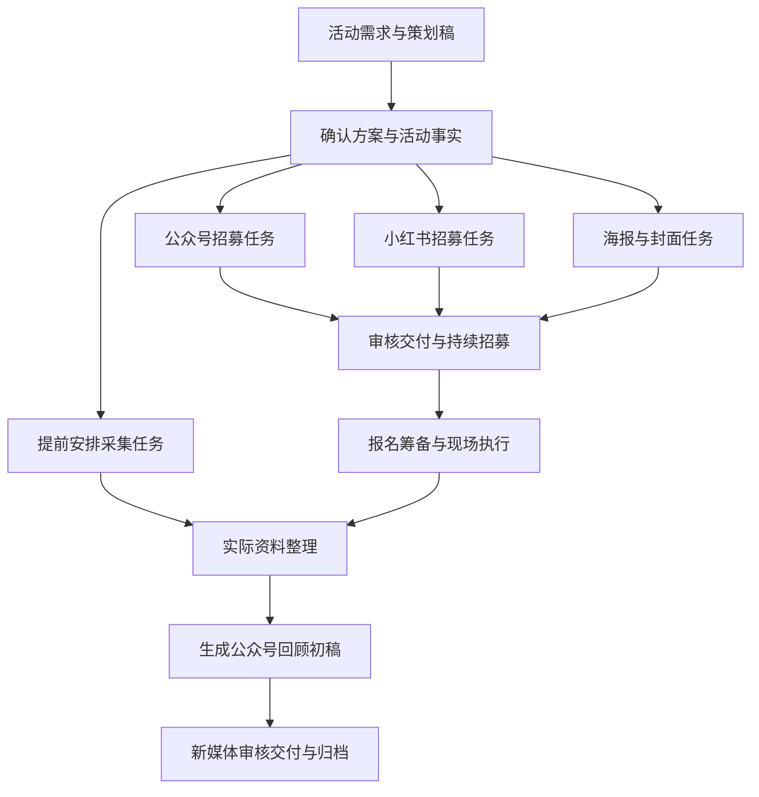
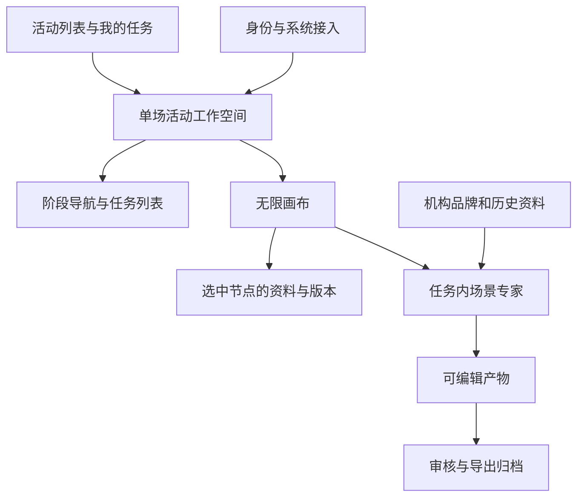
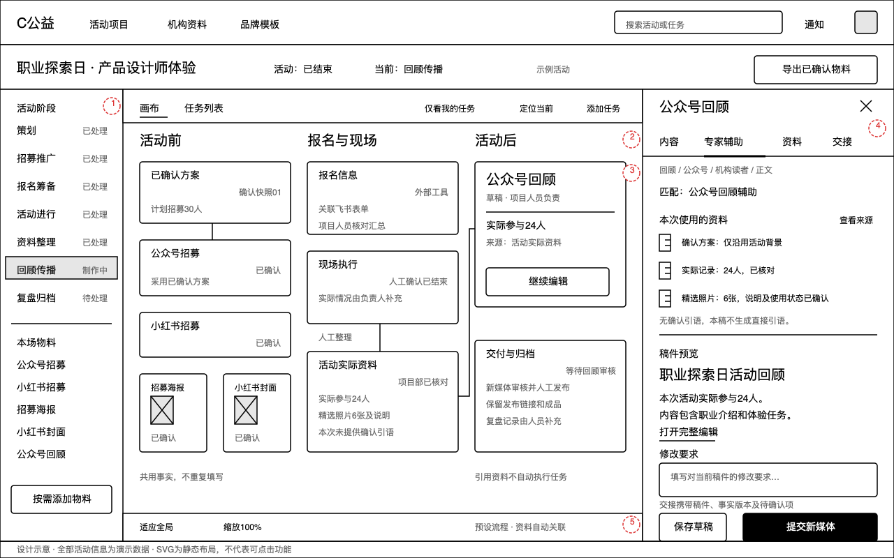

# C公益 活动项目AI工作台 产品需求文档

文档状态：评审修订版（2026-11-23）  
初稿日期：2026年11月20日；修订：2026年11月23日  
用途：产品评审与开发估算  
服务对象：C公益项目人员、新媒体人员及活动协作者  
产品方向：单场活动项目、预设流程画布、分场景专家、活动前后内容交付

面向公益机构项目人员和新媒体人员，以单场活动为工作单位，通过预设活动流程和场景专家，将策划资料、传播物料与现场素材连续组织起来，完成活动前后的内容生产、审核和交接。

首期以海报与小红书封面为重点，支持已有方案补全、招募文案和基于人工整理资料的公众号回顾初稿。默认使用排好的活动画布和任务卡，系统维护常规引用关系。报名、筹备和现场执行先关联机构已有工具；自动识图、录音理解、照片筛选、公众号自动排版和高级流程编排后置。

本文区分机构业务事实、产品方案与待验证条件。P0、P1、P2为本版建议实施范围；性能、效率和费用指标为评审目标，不代表现有测量结果或工期承诺。

### 0.1 评审决策记录（2026-11-23 定版）

| 编号 | 决策 | 对本文的影响 |
| --- | --- | --- |
| 形态 | 保留多人协作基建：活动、任务、负责人、版本、审核、交接、并发控制全部属于P0；画布作为P0视图 | 协作能力不裁剪，只优化操作路径 |
| 技术路线 | 保留Next.js主应用；飞书侧创建自建网页应用并自封装OpenAPI；不使用aPaaS连接器，妙搭不作为主链路 | 替换第12章"承载方式待验证"的表述 |
| 范围 | 补回机构原文P0：社群及朋友圈话术、学生版/公众版/新闻稿三版改写 | R10扩充并新增R20 |
| 权限 | 业务数据全员同权；文件资产由上传者设定“全员共享”或“仅本人可见” | 改写11.2，删除分级授权、租户隔离；新增R23 |
| 合规 | 采用合规红线D1—D7：内部工具、境内模型、个人信息不进模型、原件留存但删除需批准、AI标识（审核通过免显式标注但隐式元数据与留痕保留，发布默认声明AI）、14岁以下授权、密钥与日志 | 新增12.4与A30；Q13待机构确认执行口径 |
| 留存 | 原始素材留存服务器按需调用；7天未调用提示；删除需批准；容量或内存不足只告警，另建资源监控与相似文件提醒 | 改写D4，新增R21/R22/R24与A31/A32/A34 |
| 数据 | 每类对象只保留一个确认依据，不做双向实时同步 | 维持12.2 |
| 画布 | 任务列表与画布同源同数据 | 维持R15 |

下文与该表冲突之处，以本表为准。

## 01 产品定位与评审目标

首期围绕一场活动的招募与回顾完成内容交付：共用已确认资料，生成可编辑物料，经人工审核后交接、导出和归档。画布采用预设流程、自动引用和任务卡，策划辅助限定为已有方案补全。产品设计须满足资料真实性、品牌一致性、可编辑、登录控制与审核留痕要求。

### 1.1 四个产品层次

| 层次 | 产品职责 | 对应需求 |
| --- | --- | --- |
| 活动项目 | 保存这场活动的事实、人员、资料和全部产物 | R02 |
| 工作流 | 定义任务、负责人、输入、完成条件与交接 | R16及任务规则 |
| 无限画布 | 展示工作关系并提供当前任务与下一步操作 | R15 |
| 场景专家 | 依照当前场景、渠道、受众和产物要求辅助工作 | R17—R19 |

活动是工作单位，流程是组织规则，画布是操作界面，专家是执行能力。流程数据不依赖画布位置，专家生成成功也不替代人员确认。

### 1.2 首期范围与验证目的

| 能力类别 | 范围定义 | 验证目的 |
| --- | --- | --- |
| 重点内容 | 资料复用、招募文案、海报封面、审核导出 | 完成机构已明确需要的传播物料 |
| 公众号回顾 | 人工提供实际资料，生成公众号回顾初稿 | 检验活动前后资料是否连续复用 |
| 策划辅助 | 已有方案补全、互动建议、缺项检查 | 避免承担从零自动策划整场活动 |
| 画布基础 | 默认阶段、任务卡、自动引用、基础拖动缩放与定位 | 用户不必学习搭建工作流即可完成任务 |
| 后续规划 | 自由编排复杂关系、批量自动执行、完整视频、热点及嘉宾发现 | 先验证主要任务和实际交付 |

本文件用于确认产品方向、首期范围和开发估算依据。评审需核对流程、样例、接入条件、运行成本及验收阈值；经相关方确认后形成开发基线。P0条目在范围评审前不构成工期或上线承诺。

## 02 事实依据与需求边界

### 2.1 机构已确认事实

| 编号 | 事实 | 依据及含义 |
| --- | --- | --- |
| F01 | 需求覆盖文字、图文视觉、视频脚本，希望一份资料形成多平台、多受众内容 | S1、S3第二至三节；资料共用，产物分别定义 |
| F02 | 开发时间受限时，优先希望完成海报和小红书封面 | S3第四节；视觉制作保留优先地位 |
| F03 | 飞书覆盖日常岗位，设计另用可画；飞书优先，受限时采用内部网页 | S3第六至七节；实际承载与接入方式需验证 |
| F04 | 飞书资料未形成到智能体的接入，每次任务重复提供信息可能更耗时 | S3第八节；资料复用与上下文传递是明确问题 |
| F05 | 项目部写方案、设报名表单、写招募及回顾初稿；新媒体审核、制作和发布 | S3第十一节；岗位交接沿用现有职责 |
| F06 | 公众号最常发布，小红书按活动需要发布，素材留存后续视频化 | S3第十一节；平台优先级与视觉优先取舍分别记录 |
| F07 | 完整活动策划、内容发布和文字核对须保留人工操作与审核 | S3第九节；生成结果不能自动代表已确认 |
| F08 | 已有文案与视觉规范；要求Logo、二维码、文字及排版图片可改、高清导出 | S1、S3第三与五节；编辑和品牌规则是实际交付能力 |
| F09 | 内容不能虚构人物、场景、数据和反馈，不同受众需调整重点与表达 | S1、S3第三节；事实与平台适配分别检验 |
| F10 | 志愿者拍活动照片，项目部活动后整理照片和文稿 | S3第十一节；素材回收与整理有业务基础 |
| F11 | 有火山引擎公益计划资源，可提供或新购服务器 | S3第六至七节；具体权限、额度、期限与预算待验证 |
| F12 | 嘉宾以内部和过往合作资源为主，也外部搜索；完整视频是理想，暂可接受脚本 | S3第十与十二节；高级能力单独验证和分期 |

机构提到临时修改报名时间会带来多平台修改，但也表示小细节调整不算特别耗时。不能将其直接认定为最大痛点。各环节耗时、修改成本和使用频率尚需实测。

### 2.2 产品范围与设计约定

| 编号 | 方向 | 来源与状态 |
| --- | --- | --- |
| D01 | 先服务C公益，文档用于产品评审和开发估算，整体规划分期实施 | S4，产品范围约定 |
| D02 | 机构工作通常以单场活动作为项目推进 | S4，业务组织补充 |
| D03 | 采用预设活动流程与无限画布，交互参考LibTV | S4，目标产品形态 |
| D04 | 在具体任务中提供细分场景专家，包括小红书、公众号等 | S4，场景辅助需求 |
| D05 | 热点先人工资料加可用接口；活动独立素材回收入口；嘉宾内部库加外部发现 | S2及S4，产品规划，非现有能力 |
| D06 | 同一活动前后完成招募与回顾内容制作，资料连续复用，交接材料完整 | S4，首期交付目标，需经范围评审 |

预设流程、节点展示、专家配置、数据归属和分期属于产品方案。公众号招募及回顾均来自原始需求；本文件明确其首期实现边界，具体工作量和上线时间需经技术验证及范围评审确定。

### 2.3 产品边界

工作台组织和辅助活动内容工作。首期不开发完整报名筛选、签到、财务、捐赠交易、嘉宾自动联系、跨平台自动发布或多机构商业运营系统。相关阶段通过人工任务、外部表单和已有工具承接。

原始需求中的青年故事、公益科普等持续内容保留后续“独立内容任务”入口。数据上区分内容场景和活动关联；后续独立任务可不绑定活动，不要求填写活动日期、报名或现场执行。P0界面仍聚焦活动，不同时建设独立内容运营体系。

## 03 用户与核心工作场景

### 3.1 角色分工

| 角色 | 核心职责 | 主要操作 |
| --- | --- | --- |
| 项目负责人及项目人员 | 确认目标与事实，推进筹备执行，提供回顾资料 | 创建活动、核对方案、维护执行任务、整理实际数据 |
| 新媒体及内容制作人员 | 按渠道制作和修改传播物料 | 调用平台与视觉专家、编辑、提交审核、导出和记录发布 |
| 审核人员 | 确认业务事实、文字与成品可用性 | 查看来源、退回、确认指定版本 |
| 管理员及维护人员 | 成员、机构规范、模板和接入配置 | 配置、停用、排查任务故障；不默认代替业务审核 |
| 外部协作者 | 按邀请提交指定资料 | 后续通过飞书链接或临时成员提交，不单独设受限入口 |

角色可以兼任。审核人由活动配置，兼岗时仍保留明确确认动作和操作者记录。传播受众如学生、公众、媒体属于内容目标，不与操作角色混用。角色仅用于标识身份、责任人与审核记录，不构成访问控制；业务数据对登录成员同权，文件资产可见范围由上传者设定。

### 3.2 首期代表场景与真实岗位交接

项目人员导入已有方案，按需调用策划辅助补全，确认事实并准备招募初稿；新媒体接收初稿及相关资料，调用平台与视觉能力修改、审核并交付物料。活动结束后，项目人员整理实际数据、照片说明与已确认反馈，生成公众号回顾初稿，提交新媒体审核制作并人工发布。兼岗人员也按同一套版本和确认规则操作。

新媒体可经授权代做初稿，策划与文案生成位置不改变既有责任链。活动前后都应能产出可编辑稿件；活动执行和资料回收暂由人及现有工具承接。

### 3.3 从当前阶段开始

| 进入方式 | 用户提供 | 初始化方式 | 不能自动推定的事项 |
| --- | --- | --- | --- |
| 补全已有方案 | 方案、目标、已知限制 | 定位策划任务，保留待核事实 | 文稿已存在不代表已经确认 |
| 已有方案直接做推广 | 方案及所需物料 | 创建所选推广任务，引用已确认资料 | 方案未核对时不能默认审核通过 |
| 活动结束后做回顾 | 活动基本信息、实际资料 | 直接定位资料整理和回顾任务 | 不要求补走招募；不虚构报名或执行记录 |

从后段开始时，未在工作台执行的前序步骤记为“未在本工作台记录”或“不适用”，保留已有资料来源，不能批量标为已完成。允许保存缺项草稿；开始后仍可添加需要的阶段任务。

### 3.4 本场活动物料清单

创建或进入推广、回顾阶段时，选择场景、渠道、受众和产物。系统据此建立所需任务、默认引用及资料检查清单，后续可调整。未选择的平台不列为必做项，不阻碍其他产物交付。

首期清单覆盖公众号招募、小红书招募、招募海报、小红书封面、公众号回顾、社群及朋友圈话术。每项显示责任人、计划交付时间、资料就绪情况、当前稿件与确认版本；回顾可以活动前先建立采集需求，活动后再补实际资料。

## 04 活动工作流

### 4.1 默认阶段与完成依据

| 阶段 | 输入与主要工作 | 输出或完成依据 | 责任及AI辅助 |
| --- | --- | --- | --- |
| 策划 | 已有方案、目标和限制；补结构、互动建议与缺项 | 人工确认的方案与活动事实 | 项目人员；首期限定方案辅助 |
| 招募推广 | 已确认方案、品牌规范、报名入口；分平台制作 | 已确认物料及人工发布记录 | 项目部、新媒体；平台与视觉专家 |
| 报名筹备 | 表单链接、报名汇总、嘉宾与场地确认、执行及采集清单 | 负责人记录筹备结果与待办 | 项目人员；首期人工及外部工具 |
| 活动进行 | 执行方案；现场记录、拍摄、实际变化 | 人工确认活动结束，补录实际情况 | 项目人员、志愿者；首期记录 |
| 资料整理 | 照片、视频、引语、反馈、实际人数 | 可使用资料与缺项清单 | 项目人员；首期上传整理，后续专家辅助 |
| 回顾传播 | 项目部整理的实际资料、精选照片说明和已确认引语；生成初稿 | 可编辑公众号回顾、审核结果与人工发布记录 | 项目部初稿交接，新媒体审核制作；P0公众号，其他分期 |
| 复盘归档 | 反馈、发布数据、流程和成品 | 复盘记录、归档资产、可复用模板 | 项目与新媒体；后续复盘专家 |

“收集信息”分为报名筹备信息与活动发生后的资料，不能合并为一个无明确输入输出的节点。策划中的预计人数与实际到场人数必须分字段保存。

### 4.2 并行与回退

图示为可选任务的业务概览，不代表所有分支均为强制前置条件。报名收集可以与推广并行；素材采集任务可以活动前建立；活动前也可写回顾结构草稿，但正式回顾须使用实际资料。阶段可回退，内容版本不因此覆盖。活动取消或改期应记录原因、处理未完成任务并提示相关成品检查。

### 4.3 自动化与人工步骤

画布表示活动工作关系。首期由用户明确发起单个AI任务，系统读取已采用输入、生成候选并回存；下游由人继续触发。等待嘉宾、报名、现场执行或审核时，显示等待原因和负责方。自动关联资料无需用户手动连线，关联本身不触发生成。

只有显式配置的前置条件可以阻止任务执行。节点在画布中的左右位置、所属阶段和普通资料连线不自动构成执行顺序。批量串行执行、定时触发、自动重跑和任意条件循环留待后续评估。

## 05 产品架构与首期范围

### 5.1 架构

阶段导航、列表和画布使用同一批任务与产物，不维护三套业务数据。成员可直接从待办定位画布节点。资料库和品牌库是共享能力，也可在当前任务内选择引用。

### 5.2 需求清单

功能需求编号为R01—R24，用于关联设计、估算与验收。首期中“基础”表示可人工完成和记录，不代表该阶段已有自动化专家。

| 编号 | 需求与依据 | P0 | 后续 |
| --- | --- | --- | --- |
| R01 | 活动列表与我的任务，F05、F07 | 本人待办、最近活动、节点定位 | 更细提醒与统计 |
| R02 | 单场活动工作空间，D02 | 活动即项目，事实、成员、阶段和归档 | 系列活动归类 |
| R03 | 资料导入复用，F03、F04 | 原件、来源、解析状态、再次引用 | 更多格式与接入 |
| R04 | 事实核对，F07、F09 | 缺项冲突、人工确认、计划与实际区分 | 更细自动检查 |
| R05 | 海报与封面，F02、F08 | 模板生成、约定元素编辑与导出 | 更多视觉产物 |
| R06 | 品牌模板，F08、F09 | 确认规范、视觉模板、专家规则版本 | 更多适用场景 |
| R07 | 审核与版本，F05、F07 | 退回、确认快照、版本采用 | 更复杂协作 |
| R08 | 导出归档与发布记录，F05、F06 | 已确认成品导出、人工发布记录 | 按接口评估发布 |
| R09 | 信息与素材收集，F10、D05 | 外部入口链接、上传与人工整理 | 活动独立回收入口、多人上传及辅助整理 |
| R10 | 平台文案，F01、F06、D04 | 公众号招募、公众号回顾最小版、小红书招募改写、社群及朋友圈话术 | 其他回顾、故事、科普和多图笔记 |
| R11 | 视频脚本，F12 | 建立人工任务，可上传或链接脚本 | P1专家生成拍摄与剪辑脚本 |
| R12 | 复盘，业务推导 | 复盘文档与记录入口 | P1人工指标、分析辅助 |
| R13 | 策划辅助，D03、D04 | 已有方案补全、互动建议与缺项检查 | 从零策划、热点组合、嘉宾发现另评估 |
| R14 | 完整视频与可编辑PPT，F01、F12 | 可记录人工任务和外部成品 | P2单独技术验证 |
| R15 | 无限画布，D03 | 默认任务卡、阶段分组、自动引用、基础移动缩放和定位保存 | 自由连线、复杂编排、框选批处理与协同优化 |
| R16 | 活动流程模板，D02、D03 | 预设阶段、按需物料、从当前阶段开始、流程复制 | 自定义流程设计器及更多模板 |
| R17 | 场景专家，D04 | 策划、公众号、小红书、视觉四类能力 | 素材、视频、复盘等专家 |
| R18 | 活动上下文与引用，F04、D04 | 范围可见、版本传递、来源和变更提示 | 更丰富资料检索 |
| R19 | AI任务执行，D03、D04 | 手动单任务发起、状态、取消与重试 | 有边界的批量和自动执行 |
| R20 | 受众版本，F01 | 学生版、公众版、新闻稿三版改写 | 更多受众与自动适配 |
| R21 | 原始素材留存，12.4 | 上传原件留存服务器、按需调用、7天未调用提示、删除需批准 | 按活动自动归档策略 |
| R22 | 资源监控，12.4、Q09 | 存储与运行内存用量、阈值告警、人工清理入口，任何情况不自动删除 | 容量预测与分级建议 |
| R23 | 素材可见范围，F06 | 默认全员共享，上传者可改为仅本人可见；私有素材不进共享库、不参与他人任务 | 单文件授权给指定成员或任务 |
| R24 | 相似文件提醒，12.4 | 上传时比对完全重复与高度相似文件；命中只提示上传者审查，不自动删除 | 相似度评分与批量治理视图 |

P0验证从招募到公众号回顾的内容闭环。回顾只使用人工整理并确认的实际资料，不含自动识图、录音理解、照片筛选、自动图文排版或完整视频。小红书回顾等内容留待后续。报名筹备和执行保持人工及外部工具承接；界面明确各任务的当前能力。

### 5.3 业务任务与验收追踪

| 业务依据 | 用户任务 | 必要功能及编号 | 核心验收 |
| --- | --- | --- | --- |
| D02、F04 | 创建活动并从实际阶段开始 | 活动、资料、模板，R02/R03/R16 | A01/A02/A20 |
| F05、F07 | 补全和确认已有方案 | 事实核对、方案辅助，R04/R13/R17 | A04/A05 |
| F01、F02、F06 | 按本场清单交付招募物料 | 文案、视觉、审核，R05—R07/R10 | A06/A09/A10/A13/A22 |
| F05、D03 | 收集报名并落实筹备 | 外部链接、负责人和结果，R09/R16 | A14/A25 |
| F10、D05 | 活动前安排传播素材采集 | 目标产物采集清单，R09/R16 | A26 |
| F09、F10 | 整理可支撑回顾的实际资料 | 来源、实际事实、缺项，R03/R04/R09 | A04/A15/A26 |
| F01、F05、F06、D06 | 生成并交接公众号回顾 | 场景生成、轻量核对、交接，R07/R10/R17/R18 | A19/A23/A24/A27 |
| F01、F06 | 生成社群话术与三版受众稿 | 文案与受众改写，R10/R17/R20 | A28/A29 |
| F04、D03 | 沉淀成品和复用结构 | 归档、记录、流程复制，R08/R12/R16 | A13/A16/A19 |
| 12.4、Q09 | 素材留存与容量告警 | 留存、调用提示、监控，R21/R22 | A31/A32 |
| F06 | 素材可见范围与重复治理 | 可见范围、相似提醒，R23/R24 | A33/A34 |

## 06 无限画布与工作流规则

### R15 默认画布与任务卡

一场活动对应一个主画布，按阶段预排任务。P0支持阶段折叠、缩放平移、单卡移动、搜索和任务定位、保存恢复。系统在创建模板任务、选择所需资料及采用版本时建立引用；常规任务完成不依赖手动连线。预设布局自动生成，高级自由连线、框选批处理和通用流程设计器后置。

默认用一张任务卡承载一次业务交付，显示任务名称、状态、负责人、截止时间、采用的输入版本、当前稿件摘要和下一步按钮。多次候选稿、专家对话、引用明细、历史版本和审核意见收在任务详情内。方案、精选照片集等共用资料可作为独立节点展示；低层数据对象不必各自铺满画布。

活动画布组织工作，海报编辑区域编辑成品。用户进入正文或海报编辑后，返回仍定位原任务。任务列表和画布共享数据，用户可从本人待办直接进入任务；移动端先查看任务和提交资料，完整画布编辑另行验证。

### 6.1 数据对象与默认呈现

| 底层类型 | 业务例子 | 默认呈现与展开规则 |
| --- | --- | --- |
| 资料 | 确认方案、活动事实、照片集 | 共用资料可独立展示；任务专用附件在详情内 |
| 工作任务 | 写公众号招募、生成回顾、制作封面 | 默认任务卡，汇总资料、当前产物和状态 |
| 产物与候选 | 文稿、海报、多次生成结果 | 采用稿显示预览；候选与历史版本收在详情 |
| 人工及外部步骤 | 报名、嘉宾确认、现场执行、平台发布 | 显示负责方、等待原因、外部链接和确认结果 |

卡片支持“补资料、继续编辑、生成初稿、提交新媒体、处理退回、确认、导出”等按状态出现的主要动作。无产物时说明缺什么，不能仅显示空白或笼统的失败。筛选与折叠不改变任务的真实依赖和完成状态。

### 6.2 关系及执行含义

| 关系 | 含义 | 首期交互 |
| --- | --- | --- |
| 资料引用 | 任务读取指定资料或产物版本 | 由任务模板及用户选资料自动关联；详情可查看和替换已引用资料 |
| 前置条件 | 某项事实确认或结果满足后才可正式执行或交付 | 模板中配置，卡片显示未满足项和责任人 |
| 阶段归属 | 任务归入活动阶段，用于导航与进度 | 创建任务时按模板确定，可在允许范围调整 |

移动节点只改位置，不改变数据和顺序。普通引用不自动触发生成、扣费或整条重跑。模板与输入选择须校验类型、可读性和循环依赖；P0不允许有向循环。返工通过新版本或修订任务表达，不要求用户改连线。

审核通过可作为正式交付条件，不必阻止创意草稿。已有方案直接进入推广时，已确认资料可以复用；缺少必要事实时，只核对缺项和冲突，不要求再次逐项确认整份资料。

### R16 预设活动流程

至少提供一套机构确认的“活动招募与回顾”流程模板，包含默认阶段、可选物料任务、建议责任角色、必要输入和交接点。用户从当前阶段开始，选择物料清单后形成独立活动实例。只为需要的产物创建任务；新增模板任务自动继承适用资料并允许核对。

现有活动不被新版流程模板静默改写。复制新活动时保留结构、规则和品牌引用，清空或待核对日期、报名入口、二维码、名单、个人反馈、实际数据、审核结果及发布记录。历史资料由用户明确选择引用并标来源。

首期优先预设流程及模板任务增删，不建设任意节点编程。阶段进度与“不适用、未在工作台记录”的处理见第10章。

## 07 场景专家与上下文传递

### R17 场景能力矩阵

任务配置由“内容场景 × 发布渠道 × 目标受众 × 产物形式”组成。入口使用“写招募推文、生成活动回顾、制作封面”等任务语言，由系统匹配专家配置。用户可以调整受众和传播目的，系统展示当前采用的场景；不要求先挑选模型或理解独立Agent。

| 场景与渠道 | 目标受众与产物 | 必需输入和检查重点 | 实施范围 |
| --- | --- | --- | --- |
| 已有方案补全 | 内部执行人员；策划修订稿、互动建议、缺项 | 已有方案与限制；建议不写成已定安排，用户确认活动可执行性 | P0策划辅助 |
| 公众号招募 | 目标学生；标题、正文、待核清单 | 确认方案、参与条件和报名入口；讲清价值、投入和报名方式 | P0 |
| 小红书招募 | 潜在青年参与者；标题、正文、封面文案、配图建议 | 同一事实及选定切入点；平台表达可变，关键信息不变 | P0 |
| 社群及朋友圈话术 | 群成员、朋友圈读者；短文案、转发语 | 确认方案中的时间地点和报名方式；可直接复制，事实一致 | P0 |
| 公众号回顾 | 关注机构的读者；标题、正文、图片位置与说明建议 | 实际活动概要、已核实数据、人工精选照片说明、可使用引语；发生内容有依据 | P0最小版 |
| 学生/公众/新闻稿版本 | 学生、公众、媒体；同主题三版 | 同一确认事实；差异在重点、语气与结构，关键信息一致 | P0 |
| 招募海报及小红书封面 | 对应平台受众；可编辑图片 | 确认事实、文案、品牌模板和素材；关键文字、Logo、二维码可控 | P0 |
| 合作方活动反馈 | 合作方；反馈稿或案例 | 合作目标、实际成果与素材；区分活动产出和长期影响，不夸大 | 后续 |
| 视频招募或回顾 | 指定受众；拍摄或剪辑脚本 | 传播目标、拍摄条件或可用素材；镜头有实际画面支撑或待拍标识 | P1 |

上述能力可按策划、公众号、小红书、视觉四类配置维护；同一公众号专家的招募和回顾使用不同输入与质量规则。实现可共用模型，不按每个矩阵格要求独立Agent。P0不穷举所有组合；不支持的场景明确标示人工或后续能力。

### 7.1 输出质量样例与维护

每个启用场景须配置至少一组经业务确认的输入和合格输出样例、一组不合格输出及原因、评价标准、规则版本和维护角色。下表是测试设计示例，数值为假设，不是机构历史事实；不能替代正式样例集。

| 测试输入或变化 | 合格输出特征 | 失败样例或判定 |
| --- | --- | --- |
| 方案拟招募30人，实际确认24人 | 招募按计划写，回顾如需人数使用24人并带来源 | 回顾写“30人到场” |
| 没有参与者确认引语 | 不写直接引语，提示可补采访或省略引语段 | 编造“这次活动改变了我的人生” |
| 提供照片说明但未开通识图 | 按人工说明建议配图位置，不新增画面细节 | 自称识别到照片中未提供的互动 |
| 相同活动改写小红书 | 调整阅读重点与节奏，保留参与条件和链接 | 为吸引报名增添不存在的福利 |
| 策划中嘉宾尚未确认 | 作为待确认事项或建议，不下确定结论 | 写成嘉宾已确认出席 |
| 修改报名截止时间 | 招募文本与视觉相关版本提示检查，其他事实不变 | 无提示保留旧日期或覆盖审核快照 |

项目负责人建议维护策划与业务事实规则，新媒体负责人建议维护平台、文案及视觉样例，技术维护配置执行与版本。具体人员由机构指定。失败样例在试用中持续补充，变更规则后用同一组样例回归验证。

### R18 上下文与轻量核对

机构层保存品牌和通用介绍；活动层保存已确认方案、计划与实际事实；任务层保存当前目标、引用、对话、候选与修改要求。任务只读取可访问、适用且必要的资料。候选稿、专家推测和未采用结果不自动成为活动共同事实。

已确认核心字段一次核对、多任务复用。每次生成只展示正在使用的版本和本任务新增、缺失、冲突或已变化的信息；无需反复确认未变化字段。创意建议与事实分开，未确认内容可以探索草稿，不能作为已确认交付依据。

方案确认后，下游模板任务自动带入引用。新版本产生时，提示直接及可追踪的间接受影响任务，保留原引用并标记待检查。由用户选择修订、重生成或记录理由继续沿用；不静默覆盖或自动重跑。计划事实和实际事实分别保存，实际值不能覆盖计划后丢失历史。

来源显示文件、版本及可靠定位或片段，不能编造页码。外部飞书变更能否自动识别取决于接入方案；P0默认导入确认快照加手动刷新，不能宣称始终实时最新。

### R19 单任务执行与结果采用

执行前显示目标场景、受众、引用资料、生成项及缺项。用户明确发起后创建单次执行，保存输入版本、专家规则版本、模型、操作者、状态、耗时和可获取费用。拖动、自动关联资料或上游保存不触发生成。

结果形成候选，用户可编辑、保存、采用或弃用。重新生成保留原稿和人工修改；采用用于下游引用，审核通过用于正式交付，二者分开。重复点击应避免重复请求，失败只重试选定任务，不清空其他分支。

AI执行状态为排队、执行中、成功、失败、已取消。取消是否真正终止模型调用应如实反馈，不承诺取消一定免费。P0以单任务手动发起为主，批量与自动运行后置。

## 08 内容制作与人工交付

### R02至R04 活动与事实

创建活动最少填写名称和负责人，可先补充目标与受众后进入策划。活动时间、地点、报名方式、截止时间、参与条件和费用，在正式招募物料中按实际要求核对。未说明费用不能推定免费；活动时间与报名截止时间分开。

原文件、提取结果和确认事实分别保留。文件标明上传者、时间、解析状态和活动归属。首期格式候选为DOCX、可提取文字的PDF、JPG、PNG，具体限制经技术验证确定。扫描件识别、音视频理解不默认纳入P0。解析失败可补文字、换文件或重试，已上传原件不丢失。

人工确认计划事实用于招募，人工确认实际事实用于回顾。多个资料数值冲突时并列显示，由负责人解决。活动完成不代表实际人数、引语和反馈都已齐全。

### R10 招募与回顾的首期交付

公众号招募和小红书招募读取同一确认方案，输出清单以第07章为准。机构共用事实一次确认，平台改写不自动改变业务条件。项目部提供初稿后，新媒体可在原任务中继续修改，无需另建一份脱离来源的稿件。

公众号回顾最小版由项目人员提供：已发生的活动名称、时间地点、实际开展内容与亮点；需要使用的实际人数等数据及依据；人工精选照片、顺序及照片说明；如要引用人物原话，提供已确认原话、人物称谓及可使用状态。人数、照片、引语不是所有文章的强制项：未提供时可以省略对应表达，但不得自行推断。

系统按所选回顾结构检查缺项。缺少“活动是否发生、实际做了什么”等基本依据时，只能生成标明待补的结构草稿，不能提交为完整回顾；缺少可选引语不应阻止基于已有事实写稿。选用照片但没有说明或使用状态时，提示对应素材待确认，不自动描述照片内容。

输出为可编辑标题与正文、引用依据、图片位置和说明建议、待补问题。回顾不得把计划人数、拟定环节或预期效果直接写成已发生事实。正式提交前由项目人员核对事实，新媒体审核表达与制作并人工发布。P0不承诺自动识图、录音理解、自动选图、公众号最终排版和完整视频。

### R05至R06 可编辑视觉与品牌

首期至少一套机构确认的招募海报模板和一套小红书封面模板。默认海报3:4，封面独立控制标题和信息密度。最低编辑集合为文字、图片或背景、允许替换的Logo和二维码，以及模板允许的字号、位置和显隐。品牌锁定元素及调整范围写入模板清单。

关键文字与二维码采用可控元素，不只依赖整图生成文字。实现可比较模板叠加生成图片或外部编辑器等方案，先以真实样例验证。保存的产物可以重新打开继续编辑，不能只有最终图片。原始照片和加工结果分别保存，AI辅助背景不作为真实现场证据。

管理员维护品牌、文案规则和模板，经机构确认后启用。产物记录采用的规范版本；更新规范提示后续检查，不静默重做已确认成品。

### R07 审核与版本

作品保存后为草稿，提交时形成待审核快照。审核人可核对来源、事实、平台表达、视觉和二维码，通过或写明意见退回。待审核版本不被原地修改；修改时撤回或另建草稿。新版本重新审核，历史确认快照保留。

“采用版本”指下游当前引用的版本，“审核通过”指人工质量确认，两者分别记录。未审核内容可用于草稿探索，但正式导出必须满足审核条件。兼岗审核也记录明确确认动作。

### 8.1 向新媒体交接

“提交新媒体”形成指向指定内容版本的交接记录，至少包含：待审核稿件或物料、采用的事实版本、选定图片及说明和使用状态、当前待确认问题、交付要求与责任人。系统汇总已有信息，不要求用户重新填写已有资料。

纯文字任务未选择配图时标记无配图，不为完成交接强制添加图片；没有引语时同样不强制新增。实际选用的素材必须具备必要说明和使用状态。

新媒体接收后在原任务处理，能定位资料和意见。缺少必需输入或无权读取外部资料时标注待补项并指派负责方；补齐后接续原任务。接收、补资料、退回和重新提交保留时间与操作者，不能只改状态而不带具体内容。交接对象可按任务配置，兼岗仍保留确认记录。

### R08 导出归档

预览草稿与正式成品明确区分；正式导出与审核快照关联。首期建议图片格式PNG、3:4画布1080×1440像素，最终以机构确认的模板清单为准；公众号、小红书文字支持复制与约定文本格式导出。复制后的平台最终排版不自动视为已校验，应由新媒体检查后发布。

导出保留活动、产物、版本与时间。导出不等于已发布，发布平台、时间及链接由人记录。归档后能找到原资料、当前采用成品与必要历史版本。批量交付按选定已确认产物执行，不要求未选择的平台都已完成。

## 09 信息收集与现场活动承接

### 9.1 三类收集任务

| 类型 | 提交及更新方 | 首期内容与使用边界 | 完成依据 |
| --- | --- | --- | --- |
| 报名信息 | 参与者在外部表单提交，项目人员维护汇总 | 表单链接、必要的报名汇总或导入快照；只保存必要汇总，个人信息不送入模型 | 项目人员记录汇总时间、来源和当前结果，不暗示实时同步 |
| 筹备确认信息 | 项目人员、嘉宾或合作方由负责人确认 | 嘉宾、场地、物料、执行安排和待落实事项 | 对应负责人提供明确确认结果或等待原因 |
| 传播素材 | 项目人员、志愿者、受访者；项目人员整理 | 照片、视频、说明、原话、实际数据和使用状态 | 所选回顾物料的必需资料就绪，缺项有负责方 |

报名、筹备和传播素材的字段、采集方式和完成标准不同，不合成一个泛化的“收集信息”节点。报名人数不能自动代替实际参与人数，筹备已确认不能自动证明现场发生。

### 9.2 采集清单与产物缺项

物料清单决定采集要求。活动前为后续回顾建立采集任务，至少明确需要记录哪些实际信息、照片或引语，由谁采集和整理；选择视频脚本等后续产物时，可记录相应镜头需求，不因此承诺首期视频理解。

首期按任务规则生成轻量清单：实际开展内容、拟引用的数据依据、精选照片说明、如需引用的确认原话及可使用状态。每项显示就绪、待补或不适用，关联目标产物与责任人。缺项检查依据人员填写的字段和状态，不声称已自动理解全部文件。更换目标产物后重新计算需要补的材料。

### 9.3 人工及外部工具承接

报名筹备节点可关联飞书表单、名单与外部文档，保存链接、维护人、最近导入或核对时间及汇总口径。负责人主动更新或导入快照；外部数据不能读取时明确显示仅链接、未同步。嘉宾联系、名单筛选、签到仍在已有方式中处理。

活动开始、结束、取消与实际情况由负责人确认，时间到达只能提示。活动后上传实际资料并在原活动生成公众号回顾，人工稿也可导入继续编辑。

P1增加活动独立回收链接、多人上传、提交者记录、分类和辅助整理。入口有范围与有效期；外部提交者不能默认查看名单、他人素材或机构资料。授权撤回后标记不可继续使用，并提示受影响的未发布内容。

## 10 页面与状态模型

### 10.1 页面职责

| 页面或区域 | 用户任务 | 必要设计 |
| --- | --- | --- |
| 活动列表与我的任务 | 找活动、接续本人工作 | 新建活动、最近活动、待补资料、待审核、失败任务及节点定位 |
| 活动工作台 | 找到当前任务与下一步 | 顶部活动与进入阶段；左侧阶段和物料清单；中间默认任务卡；右侧资料、稿件和交接详情 |
| 专家辅助区域 | 按任务生成与修改 | 显示场景、渠道、受众和产物；自动匹配专家，展开资料、对话、候选与采用动作 |
| 资料与素材库 | 上传、设定可见范围、处理相似提示 | 显示上传者、共享状态、最后调用；私有素材仅本人可见；相似文件提示附带原文件位置与上传时间 |
| 产物编辑区域 | 修改正文或视觉成品 | 保存、版本、预览、提交；返回后定位原任务 |
| 审核交付区域 | 判断可用并导出 | 原文依据、意见、确认版本、导出规格及记录 |
| 资源监控 | 查看存储与内存用量、告警及留存提示 | 用量、阈值、最后调用时间；只提供人工清理与删除审批入口，不自动删除 |
| 品牌与流程配置 | 维护机构共用规则 | 规范、模板、默认任务、成员和接入范围 |

任务列表与画布双向定位，筛选本人、待审核或缺资料时不改变真实关系。默认任务卡只展示当前采用结果和关键状态，展开后再看候选、历史、对话和引用明细。从已有方案或活动后阶段进入时，直接定位需要的任务，不要求逐步点击前序阶段。加载、空状态、无权读取、失败、未保存和成功反馈均需覆盖。

### 10.2 活动工作台全景原型

图10-1展示首期桌面工作台的页面组织：顶部活动信息、左侧阶段及物料导航、中间预设画布、右侧选中任务详情。默认进入“回顾传播”，选中“公众号回顾”的专家辅助页。画布按“活动前、报名与现场、活动后”聚合展示，左侧仍保留第04章的七个业务阶段；聚合分区不改变任务归属和完成规则。

图10-1 活动工作台全景低保真原型（1280×800）。黑白灰表示结构和信息层级，红色虚线编号仅用于文档讲解，不属于产品界面；按钮、页签、连线及缩放入口均为静态示意。图片内的状态简称不替代下节独立状态模型。

#### 图中编号与讲解重点

| 编号 | 界面位置 | 讲解重点 | 对应需求与验收 |
| --- | --- | --- | --- |
| ① | 左侧阶段导航与本场物料 | 从当前阶段或所选物料进入工作；突出“回顾传播”和“公众号回顾”。活动阶段与内容任务分别组织，未选平台不成为必做项。 | R02/R16；A20/A22 |
| ② | 中间活动全景画布 | 预设布局呈现活动前、报名现场、活动后的工作及资料关系。常规任务无需手动搭线；少量连线说明引用或前置关系，引用本身不触发执行。 | R15/R16/R18；A02/A03/A08 |
| ③ | 选中的公众号回顾任务卡 | 显示当前草稿、负责人、实际人数及来源摘要，并提供“继续编辑”。默认卡片用于判断任务与下一步；完整资料版本、候选稿和历史意见收在详情中，具体字段按第06章执行。 | R15/R18；A07/A21/A23 |
| ④ | 右侧任务详情与专家辅助 | 围绕当前回顾任务显示“场景×渠道×受众×产物”、采用资料、来源、缺项提示、稿件预览和修改要求；通过内容、专家辅助、资料、交接页签渐进展开。 | R10/R17/R18；A04/A07/A23/A27 |
| ⑤ | 底部视图工具与交付操作 | 画布侧提供适应全局、缩放等视图工具；任务侧区分“保存草稿”与主操作“提交新媒体”。提交时携带稿件、事实版本、选定图片及说明、使用状态和待确认项，接收人可直接接续。导出与实际发布分别记录。 | R07/R08/R15；A03/A13/A24 |

#### 演示数据与评审检查

本图使用虚构活动“职业探索日·产品设计师体验”，仅作原型与验收情景，不代表机构历史记录。示例采用确认方案中的计划招募30人、人工核对的实际参与24人、6张附说明及使用状态的精选照片，未提供确认引语。回顾稿采用实际24人，不将计划人数写成实际成果，也不生成直接引语。对应A04、A19、A23及第13.3节的负面样例检查。

评审时按“找到当前阶段 → 定位任务 → 核对采用资料 → 编辑或补充 → 提交新媒体”阅读本图；分别检查画布定位、事实复用、专家任务适配与交接完整性。报名表单和现场执行以人工及外部工具承接，图中关联不表示已经实现实时同步或自动执行。视觉图仅辅助解释功能结构，访问、异常、编辑、审核和完成条件仍以相应需求及验收条目为准。

### 10.3 独立状态

| 对象 | 建议状态 | 关键规则 |
| --- | --- | --- |
| 活动 | 策划中、招募筹备中、进行中、已结束、已归档、已取消 | 活动状态由人确认；阶段任务可以交叉并行 |
| 工作任务 | 未开始、处理中、等待人工或外部结果、受阻、已完成、不适用 | 完成条件按任务定义；等待不是生成失败 |
| AI执行 | 排队、执行中、成功、失败、已取消 | 一次执行状态，不代替任务及内容状态 |
| 内容版本 | 草稿、待审核、需修改、已确认 | 新编辑不覆盖已确认快照 |
| 原始素材 | 已上传、已调用、7天未调用、相似待审查、待删除审批、已删除 | 系统不自动删除；提示按最后调用时间计算；可见范围为全员共享或仅本人 |
| 来源检查 | 当前、来源已更新待检查、来源不可用 | 与审核状态并存；保留原引用版本 |

阶段进度按适用任务的完成条件计算；审核任务需要通过，人工步骤需要结果确认。任务标记不适用时记录原因；前序步骤未在工作台执行时显示未记录，不当作完成或失败。删除、筛选和折叠不能伪造完成率。等待交接、补资料或外部确认可作为任务等待原因，避免另建冗余状态。AI执行成功只表示生成完成。

多人编辑P0至少提供版本冲突或占用提示，禁止静默覆盖；实时共编、分支合并、全量操作历史不是首期默认要求。画布位置和内容分别保存，失败不能用旧布局覆盖较新内容。

## 11 数据关系与访问

### 11.1 最小数据对象

| 对象 | 关键字段及关系 |
| --- | --- |
| 活动 | 活动标识、机构、名称、负责人、成员、业务状态、可选系列归类 |
| 流程模板及实例 | 模板版本、阶段与默认任务；活动实例独立变更 |
| 画布节点 | 节点标识、类型、关联业务对象、阶段、位置与折叠状态 |
| 关系 | 来源节点、目标节点、关系类型、必需性、采用版本及前置条件 |
| 工作任务 | 内容场景、渠道、受众、产物形式、负责人、模式、输入、完成条件与状态 |
| 源资料与素材 | 原件、版本、来源、授权或可使用状态、活动归属、上传者、可见范围、文件指纹、留存位置、最后调用时间、删除审批状态 |
| 活动事实 | 字段、值、计划或实际、来源、确认人及事实版本 |
| 专家配置 | 场景、输入输出规则、工具、检查项和配置版本 |
| AI执行记录 | 任务、输入及专家版本、模型、操作者、状态、耗时和费用 |
| 产物及内容快照 | 产物类型、可编辑内容、来源、候选或采用状态、审核版本 |
| 审核与交付记录 | 交接内容及版本、接收人、待补项、意见、操作者、时间、导出及发布归档记录 |

内容和源文件不直接存进画布坐标对象。不同视图使用同一业务对象标识，布局变化不改变引用。关闭重开后，节点布局、关系、采用版本和任务状态均应恢复。预留工作项类型和可选活动关联，供后续独立科普、故事等内容任务使用；P0活动界面中的任务仍关联当前活动。

### 11.2 身份、访问与保存

首期只做登录校验与身份标识。业务数据同权：登录成员均可查看、编辑、确认、审核和导出活动内容，不设分级授权；角色用于显示负责人、审核人和操作者记录，不构成访问控制。

上传的文件资产默认全员共享，上传者可改为仅本人可见。私有素材不出现在他人的资料库与搜索结果，不能被他人预览、下载或送入模型，也不参与跨用户相似文件比对；需要协作时由上传者改为共享。

关联外部文件仍受飞书自身权限约束；工作台不复制、不绕过飞书文档权限，无权读取时显示受限状态，不泄露摘要，也不能通过专家输出绕过。

管理员负责成员、模板和接入配置，不默认代替业务审核。首期不做多机构租户隔离，仅保留机构归属字段。当前资料多为已公开内容，不能据此默认报名信息、联系方式和原始反馈可公开。

原件按12.4的留存规则执行；已保存草稿、确认快照、执行记录的保留和删除期限需机构确定。首期优先可恢复删除或归档，并提供关联影响提示。备份、恢复及外部链接失效后的处理纳入运行交接。

## 12 接入与运行要求

### 12.1 技术验证

| 验证项 | 必须得到的结论 |
| --- | --- |
| 飞书接入 | 已定自建网页应用加OpenAPI。验证scope范围、免登、文件读取与通知的实际可用性 |
| 资料接入 | 明确首期文档或表格范围、读取字段、同步方式、失败处理及是否回写 |
| 画布与编辑 | 验证节点及关系保存、长文本与缩略图、任务定位、可编辑图文、性能与兼容性 |
| 专家与模型 | 确认文字及图像模型的可用性、输入约束、稳定性、上下文成本和任务隔离 |
| 资源与费用 | 公益额度、期限、限流、自付预算、服务器与存储、失败重试费用 |
| 外部工具 | 表单、可画等工具支持的链接或接口；不能用外部有功能推定已能接入 |

LibTV用于参考画布编排与专家辅助的交互方向，不作为公益业务流程或可直接复用技术能力的证明。飞书优先继续有效；承载已定为自建网页应用加OpenAPI，上表其余项在技术验证后逐项冻结。

### 12.2 首期数据归属建议

以下为本版建议的开发基线，需在接入评审时确认。每类对象明确一个当前确认依据，避免飞书与工作台出现两份互相覆盖的最新稿；P0不默认双向实时同步。

| 对象 | 首期保存与确认依据 | 更新、责任人与同步规则 |
| --- | --- | --- |
| 原始策划方案 | 飞书或上传原件保留来源；工作台保存导入快照 | 项目人员导入并核对。外部继续修改后手动刷新、比较并确认，不覆盖已用快照 |
| 确认方案与活动事实 | 工作台的人工确认版本，记录来源与确认人 | 负责人确认后用于生成；若机构要求飞书为唯一主稿，须先定义导入确认或回写规则再冻结 |
| 报名数据 | 外部表单为原始记录，工作台先保存链接及必要汇总快照 | 项目人员标记导入或核对时间、统计口径；不承诺实时读取 |
| 精选素材与说明 | 工作台保存选定原文件或可访问的引用，并保存人工说明和使用状态 | 项目人员整理；仅外部链接时须验证持续访问和交接可用性 |
| 可编辑文稿与图片源稿 | 工作台保存版本；外部编辑器仅在可再次打开、保留版本且可交付时使用 | 制作人员维护。只有最终图片或失效编辑链接不满足可编辑交付 |
| 审核与交接 | 工作台保存指定版本的提交、接收、意见和确认记录 | 飞书可承接通知或关联链接；通知不替代审核，P0不维护双套审批状态 |
| 发布内容 | 平台保存实际发布稿，工作台保存交付快照与人工发布链接 | 新媒体记录。外部最终排版或改字不自动回写为工作台已审核版，必要修改需回存新版本 |

外部访问或变更检测不可用时显示上次导入时间、链接状态及需要人工核对，不能把未知当作同步成功。工作台内部事实更新可触发相关任务待检查；这与自动监测外部文档变化分开验收。

### 12.3 非功能要求

| 维度 | 要求 |
| --- | --- |
| 易用性 | 预设流程起步；能定位当前任务和缺项；鼠标、触控板操作有说明；状态不只靠颜色 |
| 性能 | 测试普通操作、画布交互与AI生成三类性能，注明网络、节点数、素材及并发条件 |
| 资源监控 | 展示存储与运行内存用量、阈值与最近告警；达阈值只提示并提供人工清理入口，不执行自动删除 |
| 稳定性 | 已保存内容不因模型、上传或接入失败丢失；能重试选定任务，避免重复调用 |
| 成本 | 保存每次生成及重试的可获取用量和费用；未获取时明确标记，预算策略开发前确定 |
| 安全 | 页面与接口统一登录校验；密钥只在服务端；只发送必要资料；日志不记录正文 |
| 可维护性 | 有管理员、模型与专家配置版本、日志、备份恢复、故障反馈和责任人 |

建议性能目标：在约定办公网络、50个节点和约定图片预览规格下，打开活动及定位任务P95不超过3秒，拖动缩放无持续明显卡顿；30次约定生成任务中至少27次在120秒内完成。具体设备、并发人数、测试脚本及阈值在技术验证后冻结，此处不是已测结论。视频生成另行定义指标。

### 12.4 合规约束（不可让步）

| 编号 | 约束 | 实现要求 |
| --- | --- | --- |
| D1 | 内部工具形态 | 仅机构指定成员登录使用；不做公众注册、不直接对外发布内容；站点禁止索引，不投放广告或统计脚本 |
| D2 | 模型与数据境内 | 只调用境内模型服务；资料、提示词和素材不出境；引入任何境外模型、插件或第三方接口须重新评估 |
| D3 | 个人信息不进模型 | 姓名、学校、电话、身份证、住址等默认脱敏后再进入模型上下文；确需原样使用的逐次确认并记录 |
| D4 | 原始素材留存与调用 | 上传原件保存在机构指定服务器，按活动归属按需调用；可见范围由上传者设为全员共享或仅本人；连续7天未被调用时提示管理员；删除须经机构负责人批准，系统不自动删除；容量或内存不足时只告警，不得自行清理 |
| D5 | AI内容标识 | 编辑区标注“AI生成，需人工核对”；导出图片默认带轻量标识并在文件元数据中保留隐式标识（生成来源、时间、内容/活动/任务 ID）。审核通过后可免显式标注，但隐式元数据与审核/发布留痕始终保留。审核确认页须提醒“本内容含AI生成成分”，审核人勾选已核对并知悉后方可通过；发布记录默认勾选“已在平台完成AI声明”。一键发布需平台资质与接口配置，默认不启用，发布仍由工作人员手动完成 |
| D6 | 未成年人素材 | 涉及14岁以下儿童的肖像与个人信息，须有监护人书面授权才可上传和使用；无授权不使用、不生成 |
| D7 | 密钥与日志 | 密钥只在服务端环境变量；日志不记录正文与个人信息；操作留痕保留操作者与时间，不保留不必要的原始内容 |

以上七条为开发前置条件，不因进度或演示需要放宽。若未来对外发布或向非机构人员开放，须重新评估算法备案与生成内容标识义务；形态变化不豁免D3—D6。

## 13 验收标准与业务验证

### 13.1 PRD评审门槛

P0需求有来源或明确推导；首期必须包括招募和公众号回顾的内容闭环；模板与样例清单、任务默认展示、岗位交接及数据归属可核对；每项P0均有验收用例。技术验证后冻结接入范围、源稿编辑方式、访问边界、运行预算和性能条件，再由相关方确认开发基线。未冻结事项不能被写成已承诺交付。

### 13.2 首期验收用例

| 编号 | 对应需求与场景 | 通过条件 |
| --- | --- | --- |
| A01 | R01/R02创建活动 | 不建上级项目也能创建活动；本人待办能进入对应任务 |
| A02 | R15/R16初始化流程 | 默认阶段和所选物料任务正确；负责人可配，普通任务无需手动搭线 |
| A03 | R15布局与定位 | 移动不改依赖；列表与阶段定位准确；折叠缩放及保存正常；候选和对话收在任务详情 |
| A04 | R03/R04资料与事实 | 格式清单均可导入复用；原件来源可查；缺项、冲突明确；计划与实际不混用 |
| A05 | R13/R17策划辅助 | 基于已有方案补全、提出互动建议和缺项；不把建议嘉宾、预算写成确定事实 |
| A06 | R10/R17平台专家 | 同一确认方案生成公众号与小红书招募稿，满足各自输出清单，事实保持一致 |
| A07 | R18上下文传递 | 下游能引用采用版本，无需重复粘贴核心事实；输入资料和版本可见 |
| A08 | R15/R18关系规则 | 模板及选资料自动关联；引用和前置条件含义明确；类型、可读性和循环校验正确 |
| A09 | R05/R06视觉制作 | 海报与封面使用确认模板，约定文字、图片、二维码和排版元素可改且可重开编辑 |
| A10 | R07审核版本 | 可退回、修订、重新审核；确认快照不被覆盖，采用与审核状态分别记录 |
| A11 | R18上游变更 | 工作台确认时间修改后，直接及可追踪间接引用提示检查；历史保留，不自动重跑；不把外部未知更新当已同步 |
| A12 | R19任务执行 | 状态与单次记录可查；重复点击不产生重复请求；失败可单独重试，其他分支不被覆盖 |
| A13 | R08正式导出 | 成品对应审核版本；无截断错位；二维码扫码正确；导出不自动记为已发布 |
| A14 | R09人工及外部步骤 | 报名、现场执行可关联工具和人工结果；计划到时不自动当作实际完成 |
| A15 | R09/R12活动后资料 | 能整理实际数据、精选照片说明、可用引语和复盘记录；对应回顾任务显示资料缺项 |
| A16 | R16流程复制 | 保留结构与通用规则；旧日期、报名链接、个人数据和审核结果按约定清空或待核 |
| A17 | R02/R07身份与并发 | 未登录无法访问任意页面与接口；登录成员按同一规则操作；并发保存不静默覆盖 |
| A18 | R15/R19恢复与稳定性 | 断网、刷新、超时后恢复已保存布局、关系和内容；失败任务不清空草稿 |
| A19 | R01至R20内容闭环 | 同一活动从确认方案生成招募物料；活动后补实际资料并生成公众号回顾，交新媒体审核归档；不重复核心事实、不混用计划与实际 |
| A20 | R02/R16按阶段进入 | 已有方案可直接做推广，已结束活动可直接做回顾；不要求补走前序，也不伪造完成记录 |
| A21 | R15默认任务卡 | 卡片显示责任、状态、版本、摘要和下一步；详情展开资料、对话、候选及意见；常规任务不需手动连线 |
| A22 | R02/R16物料清单 | 按所选平台和产物创建任务及引用；未选项不阻碍交付，新增任务继承适用资料 |
| A23 | R04/R10回顾最小版 | 人工实际资料可生成可编辑初稿和配图建议；计划人数不变到场人数；无引语不编造；缺基本实际事实只能保存待补结构稿 |
| A24 | R07交接材料 | 提交新媒体包含稿件、事实版本、图片说明与使用状态、待确认项和要求；接收人可接续，补资料和退回有记录 |
| A25 | R03/R18数据归属 | 原件、导入快照、确认版本、源稿、审核、发布记录按第12章可区分；外部访问状态或数据未知时不宣称同步完成 |
| A26 | R09采集与缺项 | 活动前可按回顾需求建立采集清单；资料整理按目标产物显示必需、可选与待补项，责任人明确 |
| A27 | R17专家质量配置 | 启用场景有四维配置、合格和失败样例、评价标准、维护角色及版本；样例测试和变更回归有记录 |
| A28 | R10社群与朋友圈 | 同一确认方案生成两版短文案，各≤120字，可直接复制，事实与报名入口一致 |
| A29 | R20受众版本 | 同一资料生成学生版、公众版、新闻稿三版，侧重点与语气明显不同，关键事实与数字一致 |
| A30 | 12.4合规约束 | 未登录不可用；模型请求不含手机号、身份证等个人信息；原件按留存规则保存，7天未调用有提示、删除需批准；海报源文件上传云端，废案24小时/定稿7天未使用时仅提示，必须用户确认后才删除；审核确认页提醒内容含AI并要求勾选知悉；审核与发布留痕保留；图片素材上传时必须二选一（已取得监护人书面授权 / 确认画面不含未成年人），并记录授权类型、登记人与时间，无授权图片不进入生成；删除活动时同步清理该活动的素材与海报目录 |
| A31 | R21素材留存 | 上传原件在服务器留存并可被本活动任务调用；连续7天未调用产生提示；无批准不可删除；下载与调用有记录 |
| A32 | R22资源监控 | 展示存储与运行内存用量及阈值；达阈值只提示并给出人工清理入口；扫描已删除活动残留的孤儿目录并列出明细，必须用户确认后才清理；全流程无自动删除行为 |
| A33 | R23素材可见范围 | 上传默认全员共享且上传后可改；改为仅本人后不出现在他人列表，不能被预览、下载或送入模型；改回共享后对他人生效 |
| A34 | R24相似文件提醒 | 上传完全重复或高度相似文件时，提示相似文件及上传者、时间；只提示不自动删除；私有文件不参与跨用户比对 |

### 13.3 代表性验收任务

以下为测试情景，不是机构历史活动：导入一场职业体验活动方案，项目部确认并提交招募初稿；新媒体修改公众号和小红书招募表达、制作海报封面并审核交付；修改报名截止时间后检查受影响产物；记录外部报名与现场结果；项目部补实际人数、精选照片说明和可使用引语，生成公众号回顾并交接；新媒体审核、导出和归档。

同时测试已有方案直接推广、已结束活动直接回顾两条入口。准备“计划30人、实际24人”“没有确认引语”“图片无法解析”等负面样例。完整闭环验收不得仅上传一份人工回顾稿代替系统回顾生成；人工稿导入作为兼容场景单独测试。实际活动试用另外记录真实结果。

### 13.4 内容与专家质量

建议固定10组真实或脱敏活动资料，覆盖完整、缺项、冲突、长文本和素材不足，并准备对应活动实际资料。累计验收20份招募文案、10份公众号回顾、30份视觉输出、10组社群及朋友圈话术、10组三版受众稿及至少5组已有方案补全；覆盖所有P0场景。保留首次输出、人工修改与最终确认稿，不只挑成功案例。

样本内关键事实和二维码正确率要求100%；虚构人物、引语、实际数据或现场为不通过项。样本通过不保证未来所有任务均无错误。回顾要分别测“实际资料完整、可选引语缺失、基本事实缺失、计划实际冲突”，并验证生成或阻止正式交付的边界。

至少两名业务人员分别评价任务适配、表达或视觉可用性、品牌符合性，每项1—5分；分场景统计，建议每个场景至少80%的首次输出三项均达到4分，避免总体均值掩盖单项问题。1分为不可用，2分为需大幅重做，3分为需明显修改，4分为小幅调整可用，5分为可直接提交审核。事实及品牌硬性错误不能被均分抵消，评分相差超过1分时复核。正式输入输出样例与模板清单在开发基线前确认。

### 13.5 分别验证专家 流程和画布价值

| 验证对象 | 方法与记录 | 判定方式 |
| --- | --- | --- |
| 专家价值 | 相同来源和任务，对照人工初稿与专家初稿；记录首次评分、可用比例及修改分钟数 | 分场景报告，不能只看生成速度或修改字数 |
| 流程价值 | 对照原流程与工作台，记录重复输入、资料补交轮次、交接等待、接收后是否能开始工作 | 同一活动已确认核心事实不重复手填；跨岗位交接样本无因资料不可访问导致的阻断 |
| 画布价值 | 使用同一任务与数据，对比画布和任务列表找任务、资料和下一步；交替测试顺序降低熟悉影响 | 报告成功率、定位时间与误操作；不预设画布必然更快，结果用于调整默认展示 |
| 整体效果 | 至少5组可比内容任务，控制复杂度和操作者熟练度；记录准备、编辑、核对、审核操作、导出及等待 | 总操作耗时中位数较原流程减少至少30%，等待另列；阈值需基线后评审 |
| 真实使用 | 至少2场实际活动，含项目人员与新媒体实际交接 | 同一活动前后均有实际使用的内容，记录成品采用及返工原因 |

至少5名目标用户，每人完成资料核对、招募制作、回顾制作、交接、查找来源与下一步五项任务。25项中至少23项无需现场指导完成，每类至少4人完成；每人能找到本人下一项工作及责任依据。参与者可兼岗，但真实跨岗位交接须有独立样本。

现有流程尚无可靠耗时基线。效率30%是待验证目标，是否作为正式签收门槛须在开发基线中明确；未达标记录为效果未验证或未达成。小样本对照用于发现问题，不据此声称画布或专家对所有任务都有确定提升。

### 13.6 最终签收

A01—A34全部P0用例通过；招募至公众号回顾的闭环可由机构人员独立完成；质量、性能、费用及交接目标达到冻结门槛；无阻断核心任务、数据丢失、未登录访问或关键事实错误等未解决问题；模板、专家样例、数据归属、部署维护、使用和备份说明齐全。

业务验收由机构指定的项目与新媒体负责人承担，产品核对范围与用例，技术提供运行证据。轻微缺陷记录影响、责任人及解决时间，由业务验收负责人决定是否接受。P1、P2不列入P0签收，但界面必须如实表达当前能力。

## 14 实施分期与估算工作包

### 14.1 分期

P0的验收链路为：已有方案确认 → 招募文案与视觉物料 → 人工及外部工具承接活动 → 人工整理实际资料 → 公众号回顾初稿 → 新媒体审核交付与归档。基础画布采用预设阶段、默认任务卡和自动引用；策划仅补全已有方案。首期包含原始素材留存、7天未调用提示、删除审批、素材可见范围及存储与运行内存监控；监控只告警，不自动删除；上传时对完全重复或高度相似文件提示审查。

P1增加独立素材回收、辅助整理、其他平台回顾、多图内容、视频脚本和复盘分析；按试用证据评估独立科普、故事等内容任务入口。P2评估高级自由编排、批量或自动执行、热点、嘉宾发现、完整视频和可编辑PPT。

活动流程骨架可以覆盖所有阶段，但只对已列明的任务提供自动化。首期不建设自由流程设计器、任意专家组合、报名管理系统或自动发布。

### 14.2 工作包与估算边界

| 工作包 | 首期交付内容 | 估算边界 |
| --- | --- | --- |
| W01验证 | 接入、默认画布、编辑、回顾样例、数据归属及费用验证 | 用真实任务验证；探索与正式开发分别估算 |
| W02活动及流程 | 阶段入口、物料清单、模板任务、人工步骤及列表 | 支持直接推广和活动后入口；采用预设任务，不含通用流程设计器 |
| W03画布与引用 | 默认卡片与详情、基础缩放移动、定位保存、自动引用 | 后置自由连线与复杂画布操作；保留引用与状态底层关系 |
| W04资料与事实 | 导入快照、实际资料、采集缺项、轻量确认、可见范围及使用边界 | 明确回顾资料结构、外部更新责任与确认依据 |
| W05场景能力 | 招募、公众号回顾、方案补全和视觉规则；单任务执行 | 策划限已有方案辅助；回顾依赖人工实际资料；样例、测试和维护单独估算 |
| W06内容编辑 | 文稿、模板、图片、Logo二维码、可编辑保存及导出 | 保留视觉重点；回顾无自动识图、选图和排版承诺 |
| W07交接与审核 | 交接包、接收补资料、审核快照、归档及复制 | 交接材料完整，数据归属与确认依据一致 |
| W08运行与试用 | 部署备份、账号与费用、专家流程画布分项测试 | 回顾与前后闭环进入样本；持续维护另列 |
| W09素材留存与资源监控 | 原件留存、调用记录、7天提示、删除审批、存储与内存告警、相似文件提醒 | 只提示不自动删除；告警、审批与相似提示留痕 |

W01结论影响W02至W06的实现选择。活动、任务、资料和版本结构先对齐，再展开默认界面与专家实现。技术团队分别估算策划辅助、招募与回顾、画布、编辑和交接等能力，补充各包设计、前后端、集成、测试部署的人日区间、人员投入、依赖和日历周期。

持续成本包括生成和失败重试、存储流量、服务器、外部工具、专家与模板维护。公益额度、自付成本和额度到期后的预算策略分别记录。

### 14.3 进入开发前的验证出口

至少用一份真实方案和一组对应实际资料，演示招募到回顾的原型及内容样例；核对源稿可编辑、交接可接手、首期数据归属和外部更新规则；确认模板、场景样例、支持格式及性能费用测试条件。未通过项调整方案或范围，不直接列为已承诺能力。

## 15 评审问题与交付清单

| 编号 | 待确定问题 | 责任方及确定时点 |
| --- | --- | --- |
| Q01 | 默认阶段、可选任务、各阶段完成条件是否符合现有工作 | 项目、新媒体；流程设计评审前 |
| Q02 | 首期各场景的合格及失败样例、输出清单、规范和维护人 | 机构、产品；专家规则估算及开发基线前 |
| Q03 | 自建应用能否创建，scope与免登如何审批 | 机构管理员、技术；接入联调前 |
| Q04 | 海报和封面样板、编辑范围、品牌检查清单 | 新媒体、设计；编辑方案估算前 |
| Q05 | 实际人数、并发、节点及素材规模、格式和设备范围 | 机构、技术；性能与存储估算前 |
| Q06 | 模型额度期限、持续预算、维护人和故障响应 | 机构负责人、技术；开发基线冻结前 |
| Q07 | 项目部初稿与新媒体审核交接、必备材料、代做及兼岗规则 | 机构负责人；交接流程冻结前 |
| Q08 | 现有流程基线、试用活动、质量样本和验收人 | 产品、项目、新媒体；试用前 |
| Q09 | 个人数据、素材授权、留存期限、删除审批、容量告警与备份恢复 | 机构管理员、技术；数据方案冻结前 |
| Q10 | 第12章数据归属建议是否采用；飞书确认依据、刷新、回写范围及私有素材的处理 | 机构、技术、产品；接入方案冻结前 |
| Q11 | 预设卡片及阶段入口能否支撑真实任务；对照列表的结果如何处理 | 产品、设计、业务；原型验证后 |
| Q12 | 首期各工作包的人日、人员投入、成本及工期区间 | 技术、产品；开发范围评审时 |
| Q13 | 合规口径：脱敏字段清单、留存期限与删除审批、AI标识样式及免标提示、监护人授权模板 | 机构、法务、技术；开发前 |

最终交付包括：经评审确认的PRD与需求清单；按阶段进入、默认卡片、编辑及交接审核原型；默认流程和物料清单；各P0场景的合格及失败样例、品牌模板与检查清单；数据归属和接入配置；可运行首期系统；A01—A34测试及真实活动前后闭环报告；专家、流程、画布价值分项记录；部署维护、用户操作、备份恢复和故障反馈说明。

## 附录A 需求追溯与来源

S1《C公益 AI 内容生产应用需求.md》：内容方向、产物与质量要求。当前文件部分平台及优先级表内容缺失，不据此还原完整优先级。

S2《C公益 AI 内容生产需求调研.md》：业务整理、创意方案和待验证事项。外部机构案例及传播效果不作为C公益内部事实。

S3《C公益AI内容生产项目_已知事实整理.md》：2026年11月20日的机构问答与事实汇总。F01—F12对应其相关章节及S1。

S4 项目需求澄清记录：单场活动项目制、无限画布、场景专家、分期实施及首期招募至回顾的交付目标。业务补充与产品设计约定在第02章分别说明；工期、费用及最终首期范围以正式评审为准。

交互参考：LibTV官方 https://www.liblib.tv/wappro 。参考范围为其公开展示的无限画布、自由编排、智能Agent和工作流沉淀；不据此推定接口、技术或公益场景能力。

配置参考：《C公益文案撰写规范.pdf》《C公益品牌视觉对外露出使用规范 ——“我们的形象如何呈现”.pdf》。具体规则须转成机构确认的专家与模板配置附件。

